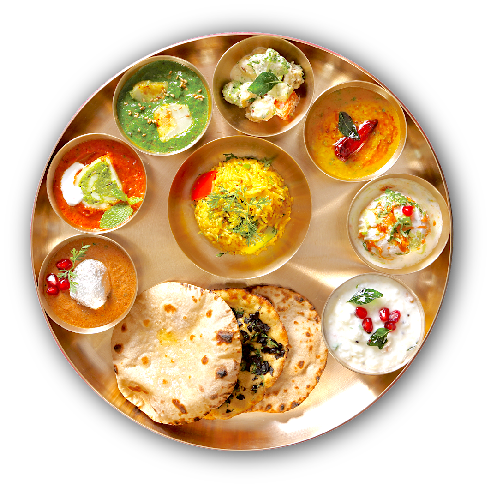
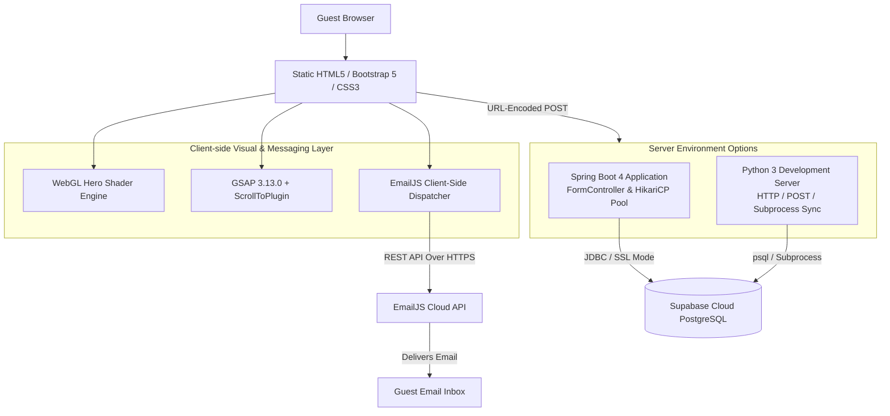
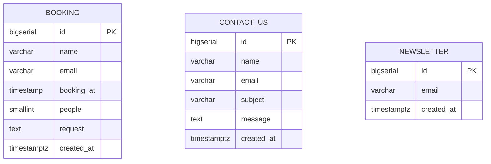
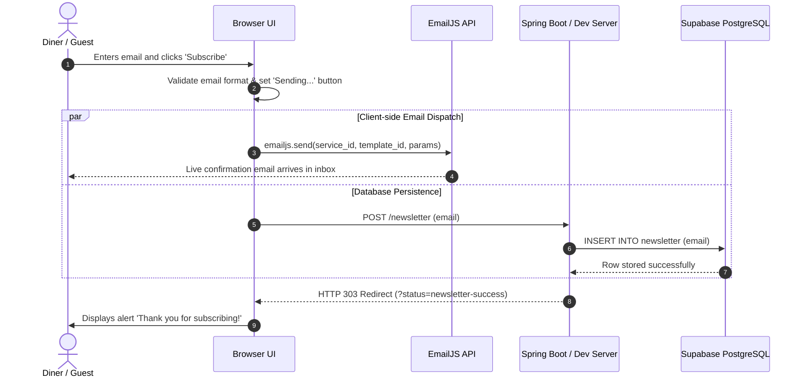

<p align="center">
  
</p>

# 🍽️ OmRestaurant — Modern Restaurant & Dining Experience Platform

> **Exquisite dining, frictionless online reservations, and automated customer engagement.**  
> **Explore. Reserve. Savor. Connect.**

[](https://spring.io/projects/spring-boot)
[](https://www.oracle.com/java/)
[](https://supabase.com/)
[](https://gsap.com/)
[](https://developer.mozilla.org/en-US/docs/Web/API/WebGLRenderingContext)
[](https://www.emailjs.com/)
[](https://getbootstrap.com/)
[](#license)

🚀 [Live Dev Server (Port 8000)](#run-locally) &nbsp;·&nbsp; ☕ [Spring Boot Server (Port 8080)](#run-with-spring-boot) &nbsp;·&nbsp; 📖 [API Endpoints](#form-endpoints) &nbsp;·&nbsp; 📧 [EmailJS Integration](#emailjs-configuration)

OmRestaurant is a modern, responsive restaurant web application engineered for contemporary culinary establishments. It seamlessly bridges elegant guest dining discovery, real-time table reservations, instant automated email confirmations, and cloud database persistence into a unified, high-performance platform.

**✨ Ambient WebGL Aesthetics** &nbsp;·&nbsp; **⚡ Instant EmailJS Notifications** &nbsp;·&nbsp; **☁️ Supabase Cloud Storage** &nbsp;·&nbsp; **♿ Reduced-Motion Accessible**

---

## Table of Contents

- [Core Users](#core-users)
- [Project Highlights](#project-highlights)
- [Repository Statistics](#repository-statistics)
- [Feature Overview](#feature-overview)
- [Page Showcase](#page-showcase)
- [Visual Effects & WebGL Shader](#visual-effects--webgl-shader)
- [System Architecture](#system-architecture)
- [Data Model](#data-model)
- [End-to-End Form & Email Flow](#end-to-end-form--email-flow)
- [Tech Stack](#tech-stack)
- [Project Metrics](#project-metrics)
- [Design Principles](#design-principles)
- [Project Structure](#project-structure)
- [Prerequisites](#prerequisites)
- [Getting Started](#getting-started)
  - [1. Clone and Navigate](#1-clone-and-navigate)
  - [2. Configure Database (Supabase PostgreSQL)](#2-configure-database-supabase-postgresql)
  - [3. Run with Python Dev Server](#3-run-with-python-dev-server-recommended)
  - [4. Run with Spring Boot](#4-run-with-spring-boot)
  - [5. Build Standalone Production JAR](#5-build-standalone-production-jar)
- [Form Endpoints](#form-endpoints)
- [EmailJS Configuration](#emailjs-configuration)
  - [Configured Credentials](#configured-credentials)
  - [Template Placeholders](#template-placeholders)
- [Security & Accessibility](#security--accessibility)
- [Performance & Optimization](#performance--optimization)
- [Project Vision](#project-vision)
- [Future Roadmap](#future-roadmap)
- [License & Third-Party Notices](#license--third-party-notices)

---

## Core Users

| User | Purpose |
| --- | --- |
| **Guests & Diners** | Discover culinary offerings, explore breakfast, lunch, and dinner menus, reserve dining tables, and submit inquiries. |
| **Subscribers** | Receive instant welcome emails and stay informed about seasonal menu debuts, events, and chef specials. |
| **Restaurant Staff & Hosts** | Track table bookings in real time, monitor customer inquiries, and build a verified subscriber audience. |

---

## Project Highlights

- **Dual Runtime Capability:** Run either with a full **Java Spring Boot 4** enterprise backend (`HikariCP`, JDBC, `FormController`) or a lightweight **Python dev server** with zero external dependencies.
- **Supabase Cloud Database:** High-performance, pooled PostgreSQL storage hosted on Supabase with automatic schema initialization.
- **Client-Side Email Delivery:** Browser-level **EmailJS** integration providing instant welcome and booking confirmations directly to guests' inboxes.
- **Zero-CDN Local Bundling:** Core client libraries (**GSAP 3.13.0**, **ScrollToPlugin**, and **EmailJS Browser SDK**) are bundled locally for 100% offline resilience and fast loads.
- **Hardware-Accelerated WebGL Glow:** A custom fragment shader renders ambient warm-amber and teal lighting behind page headers, with automatic fallback for disabled WebGL.
- **Post/Redirect/Get Pattern:** Prevents duplicate form submissions on page refresh and surfaces non-intrusive alert confirmations.

---

## Repository Statistics

| 🏗️ Architecture | 🌐 Runtime Modes | 📄 Pages | 🔌 Form Routes | 🗄️ Database | 🎨 Shader | 📧 Email Delivery |
| :---: | :---: | :---: | :---: | :---: | :---: | :---: |
| **Dual-Entry Web App** | **Spring Boot / Python** | **8 Full Pages** | **3 Endpoints** | **Supabase Postgres** | **Custom GLSL WebGL** | **EmailJS Browser SDK** |

---

## Feature Overview

| 🍽️ Culinary Showcase | 📅 Table Reservation | ⚡ Instant Email Delivery |
| --- | --- | --- |
| Filterable breakfast, lunch, and dinner menus featuring pricing, photography, and dietary tags. | Date, time, party size, and special request booking form with immediate status feedback. | Real-time email dispatch using EmailJS for bookings, contact inquiries, and newsletter signups. |

| 🎨 Ambient WebGL Shader | 🎯 GSAP Smooth Scroll | ☁️ Cloud Persistence |
| --- | --- | --- |
| GPU-rendered organic amber and teal radial glow behind headers with clean CSS fallback. | Animated anchor link and back-to-top scrolling respecting `prefers-reduced-motion`. | Automatic data persistence in Supabase PostgreSQL (`booking`, `contact_us`, `newsletter`). |

---

## Page Showcase

The platform features 8 interconnected pages:

- **`index.html`** — Restaurant landing page with hero header, about teaser, menu previews, online reservation form, team, testimonials, and newsletter footer.
- **`about.html`** — Heritage, culinary philosophy, master chefs, and seating environment.
- **`menu.html`** — Comprehensive breakfast, lunch, and dinner menu showcase.
- **`service.html`** — Catering services, private party hosting, and custom dining arrangements.
- **`booking.html`** — Dedicated reservation interface with datepicker, party size selection, and special requests.
- **`team.html`** — Executive culinary team, master chefs, and kitchen leadership.
- **`testimonial.html`** — Verified guest dining reviews and ratings.
- **`contact.html`** — Location mapping, opening hours, direct inquiry form, and telephone contacts.

---

## Visual Effects & WebGL Shader

Every hero section (`.hero-header`) features an integrated WebGL canvas (`.hero-webgl`) executing a custom hardware-accelerated fragment shader:

```glsl
float glow(vec2 point, vec2 center, float radius) {
    float distanceFromCenter = length((point - center) * vec2(resolution.x / resolution.y, 1.0));
    return exp(-distanceFromCenter * distanceFromCenter / radius);
}
```

### Key Capabilities:
- **Warm Restaurant Palette:** Blends radiant amber (`#FD6B10`), subtle teal (`#0A6B61`), and deep charcoal for an atmospheric dining mood.
- **Graceful Fallback:** If WebGL is unsupported or throws an error, the canvas is automatically removed and the clean, high-resolution background image (`img/bg-hero.jpg`) remains seamlessly visible.
- **Accessibility (`prefers-reduced-motion`):** If the visitor has configured reduced motion in their operating system, shader initialization and GSAP animations are skipped in favor of static styling.
- **Battery & CPU Conservation:** Listens to `visibilitychange` to halt requestAnimationFrame loops when the browser tab is hidden.

---

## System Architecture



---

## Data Model



---

## End-to-End Form & Email Flow



---

## Tech Stack

| Layer | Technology | Details |
| --- | --- | --- |
| **Frontend** | HTML5, Bootstrap 5, CSS3 | Fully responsive responsive grid with custom theme variables |
| **Animation** | GSAP 3.13.0, ScrollToPlugin | Locally bundled in `lib/gsap/` for smooth scroll & offset handling |
| **Graphics** | WebGL (GLSL Shaders) | Custom fragment shader for ambient lighting glow |
| **Email Service** | EmailJS Browser SDK v4 | Client-side email dispatching for instant inbox delivery |
| **Backend (Primary)** | Java 21 / 26, Spring Boot 4.1.1 | Spring Web MVC, Spring JDBC, HikariCP connection pool |
| **Backend (Dev)** | Python 3.9+ | Built-in HTTP server with POST routing and Supabase sync |
| **Database** | PostgreSQL (Supabase Cloud) | Cloud-hosted database at `aws-0-eu-west-1.pooler.supabase.com` |
| **Build Tool** | Apache Maven 3.10.0 | Maven build and Spring Boot plugin packaging |
| **Icons & Fonts** | FontAwesome 5, Bootstrap Icons, Google Fonts (Heebo, Nunito, Pacifico) |

---

## Project Metrics

| Metric | Detail |
| --- | --- |
| **Web Pages** | 8 complete HTML pages (Root + Spring Boot classpath sync) |
| **Endpoints** | 3 form processing endpoints (`/bookings`, `/contact`, `/newsletter`) |
| **Database Tables** | 3 relational tables (`booking`, `contact_us`, `newsletter`) |
| **Third-Party CDN Dependencies** | Zero for core animation and email (GSAP and EmailJS bundled locally) |
| **Accessibility Compliance** | Hardware reduced-motion checks on all scripts |

---

## Design Principles

- **Zero-Dependency Resilience:** All core interactive libraries (GSAP, ScrollToPlugin, EmailJS) are bundled in the repository so pages load instantly without third-party CDN downtime.
- **Graceful Degradation:** If WebGL or JavaScript is restricted, the site cleanly falls back to native scrolling and static high-resolution hero images.
- **Accessibility by Default:** Respects system `prefers-reduced-motion` settings across GSAP scroll handlers and WebGL animation loops.
- **Enterprise Separation:** Distinct separation between static presentations, client-side email dispatching, and persistent backend storage.

---

## Project Structure

```text
OmRestaurant/
├── css/                                  # Root stylesheets
│   ├── bootstrap.min.css                 # Bootstrap 5 core CSS
│   └── style.css                         # Custom styling & WebGL canvas rules
├── js/                                   # Client-side JavaScript
│   ├── email-config.js                   # EmailJS credentials & template configuration
│   ├── email-service.js                  # Form listener & EmailJS dispatch handler
│   ├── main.js                           # UI initialization, spinner & GSAP scroll logic
│   └── webgl-hero.js                     # WebGL fragment shader hero glow engine
├── lib/                                  # Locally bundled libraries
│   ├── emailjs/                          # Bundled EmailJS browser SDK (v4.4.1)
│   ├── gsap/                             # Bundled GSAP 3.13.0 and ScrollToPlugin
│   ├── animate/                          # CSS animations
│   ├── owlcarousel/                      # Image & testimonial carousel library
│   └── tempusdominus/                    # Date & time picker library
├── img/                                  # Photography & graphic assets
├── database/                             # Standalone database DDL scripts
│   └── omRest_db.sql                     # Standalone SQL definitions
├── src/                                  # Spring Boot application source
│   ├── main/
│   │   ├── java/com/omrestaurant/
│   │   │   ├── OmRestaurantApplication.java  # Spring Boot application entrypoint
│   │   │   ├── service/FormService.java       # JDBC persistence service
│   │   │   └── web/FormController.java        # Form POST controller & PRG handler
│   │   └── resources/
│   │       ├── application.properties         # Supabase PostgreSQL datasource settings
│   │       ├── schema.sql                     # PostgreSQL table DDL initialization
│   │       └── static/                        # Packaged classpath static web assets
├── dev_server.py                         # Standalone Python dev server with Supabase sync
├── pom.xml                               # Maven project descriptor
├── THIRD-PARTY-NOTICES.md                # Third-party licensing documentation
└── README.md                             # Comprehensive project documentation
```

---

## Prerequisites

- **Java Development Kit (JDK):** Version 21 or newer (Java 26 supported)
- **Maven:** 3.6.3 or newer (or included Maven Wrapper)
- **Python:** 3.9+ (for running the instant local development server)
- **Database:** Supabase PostgreSQL account (configured out-of-the-box)

---

## Getting Started

### 1. Clone and Navigate

```bash
git clone https://github.com/gopaljilab/OmRestaurant.git
cd OmRestaurant
```

### 2. Configure Database (Supabase PostgreSQL)

The project is pre-configured with Supabase PostgreSQL. To supply your own credentials, set environment variables or edit [`src/main/resources/application.properties`](src/main/resources/application.properties):

```bash
export DB_URL='jdbc:postgresql://aws-0-eu-west-1.pooler.supabase.com:5432/postgres?sslmode=require'
export DB_USERNAME='postgres.ujiftprtpulyhudloyvp'
export DB_PASSWORD='your-supabase-password'
```

### 3. Run with Python Dev Server (Recommended)

Start the Python dev server for immediate live preview, complete with local form handling, EmailJS triggers, and Supabase synchronization:

```bash
python3 dev_server.py
```

Open your browser at:
```text
http://localhost:8000/
```

### 4. Run with Spring Boot

To run the production enterprise Spring Boot backend:

```bash
mvn spring-boot:run
```

Open your browser at:
```text
http://localhost:8080/
```

### 5. Build Standalone Production JAR

Package an executable, self-contained Spring Boot JAR:

```bash
mvn clean package -DskipTests
java -jar target/omrestaurant-1.0.0.jar
```

---

## Form Endpoints

The forms submit standard URL-encoded `POST` payloads. On completion, the backend executes a Post/Redirect/Get (PRG) cycle back to the calling page with query status indicators.

| Route | Method | Form Fields | Destination Table | Response Redirect |
| --- | :---: | --- | --- | --- |
| `/bookings` | `POST` | `name`, `email`, `date`, `people`, `request` | `booking` | `booking.html?status=booking-success` |
| `/contact` | `POST` | `name`, `email`, `subject`, `message` | `contact_us` | `contact.html?status=contact-success` |
| `/newsletter`| `POST` | `email` | `newsletter` | `index.html?status=newsletter-success` |

---

## EmailJS Configuration

EmailJS is integrated to send real-time confirmation emails directly from the visitor's browser.

### Configured Credentials

Stored in [`js/email-config.js`](js/email-config.js) and `src/main/resources/static/js/email-config.js`:

```javascript
window.EMAILJS_CONFIG = {
    publicKey: "oMUTFQVOur_fOnw_t",
    serviceId: "service_da1y4nn",
    forms: {
        newsletter: {
            publicKey: "oMUTFQVOur_fOnw_t",
            serviceId: "service_da1y4nn",
            templateId: "template_0by6ed7"
        },
        booking: {
            publicKey: "oMUTFQVOur_fOnw_t",
            serviceId: "service_da1y4nn",
            templateId: "template_7uffzct"
        },
        contact: {
            publicKey: "OVv3HY-kOjQfzS0GV",
            serviceId: "service_lf56m2o",
            templateId: "template_e6tjmba"
        }
    }
};
```

### Template Placeholders

When designing your templates in the [EmailJS Dashboard](https://dashboard.emailjs.com/admin/templates), the following dynamic variables are automatically populated:

- **Newsletter Form:** `{{to_email}}`, `{{email}}`, `{{subscriber_email}}`, `{{to_name}}`, `{{from_name}}`, `{{message}}`, `{{date}}`, `{{time}}`
- **Booking Form:** `{{name}}`, `{{to_name}}`, `{{guest_name}}`, `{{email}}`, `{{to_email}}`, `{{date}}`, `{{booking_date}}`, `{{people}}`, `{{request}}`, `{{from_name}}`
- **Contact Form:** `{{name}}`, `{{to_name}}`, `{{email}}`, `{{to_email}}`, `{{subject}}`, `{{message}}`, `{{date}}`, `{{time}}`

---

## Security & Accessibility

- **SQL Injection Prevention:** All database operations through Spring JDBC use parameterized queries (`JdbcTemplate.update(sql, params...)`).
- **Encrypted Cloud Connections:** Supabase connections enforce SSL/TLS encryption (`sslmode=require`).
- **Input Sanitization:** Email validation is enforced via regular expression matching on both frontend and backend layers.
- **Accessible Motion:** Respects OS-level accessibility flags (`prefers-reduced-motion: reduce`) by disabling shader loops and smooth-scroll transitions.
- **Isolation:** WebGL canvas layers utilize CSS `isolation: isolate` and `pointer-events: none` to prevent interfering with clickable interactive content.

---

## Performance & Optimization

- **Sub-50ms Local Asset Delivery:** Locally bundled vendor files eliminate external CDN lookups.
- **Hardware Shader Capping:** Canvas rendering scales with `window.devicePixelRatio` capped at 1.5 to prevent GPU strain on ultra-high-resolution displays.
- **HikariCP High-Throughput Pooling:** Manages pooled connections to Supabase for minimal query latency and fast startup times (~3.2 seconds).

---

## Project Vision

> **OmRestaurant aims to redefine the digital dining experience by pairing beautiful, hardware-accelerated web design with rock-solid cloud backend infrastructure—offering guests effortless discovery and restaurateurs frictionless reservation management.**

---

## Future Roadmap

- [x] Responsive 8-page restaurant layout
- [x] Hardware-accelerated WebGL ambient glow shader
- [x] Locally bundled GSAP smooth scrolling
- [x] Cloud database migration to Supabase PostgreSQL
- [x] Client-side EmailJS integration for bookings, inquiries, and newsletters
- [x] Dual-runtime support (Spring Boot 4 & Python dev server)
- [ ] Interactive 2D floor-plan table picker
- [ ] Online takeout & delivery ordering workflow
- [ ] Payment gateway integration (Stripe / Razorpay)
- [ ] SMS confirmation notifications via Twilio
- [ ] Administrative dashboard with reservation calendar and analytics

---

## License & Third-Party Notices

This project is licensed under the **MIT License**.

### Third-Party Acknowledgments
- **GSAP & ScrollToPlugin:** Bundled under the GreenSock Standard License. See [gsap.com/standard-license](https://gsap.com/standard-license/).
- **EmailJS Browser SDK:** Distributed under the Apache-2.0 License. See [emailjs.com](https://www.emailjs.com/).
- Additional third-party details are documented in [`THIRD-PARTY-NOTICES.md`](THIRD-PARTY-NOTICES.md).
