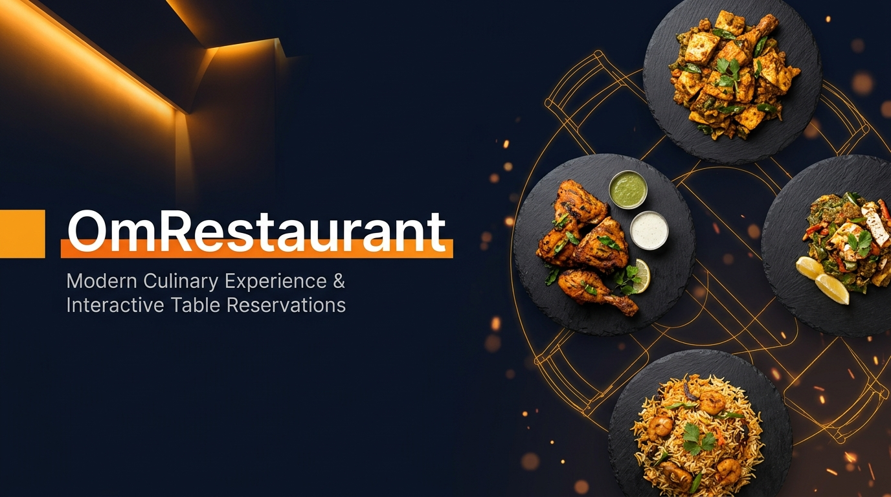
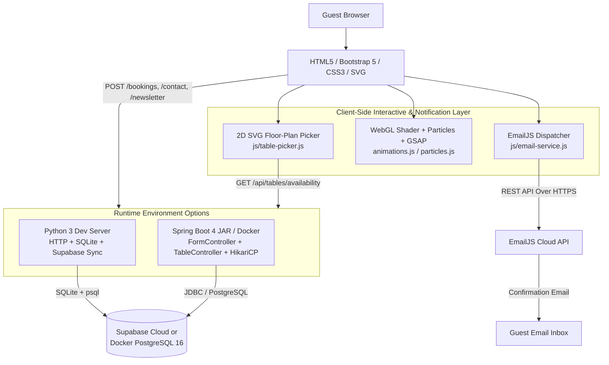
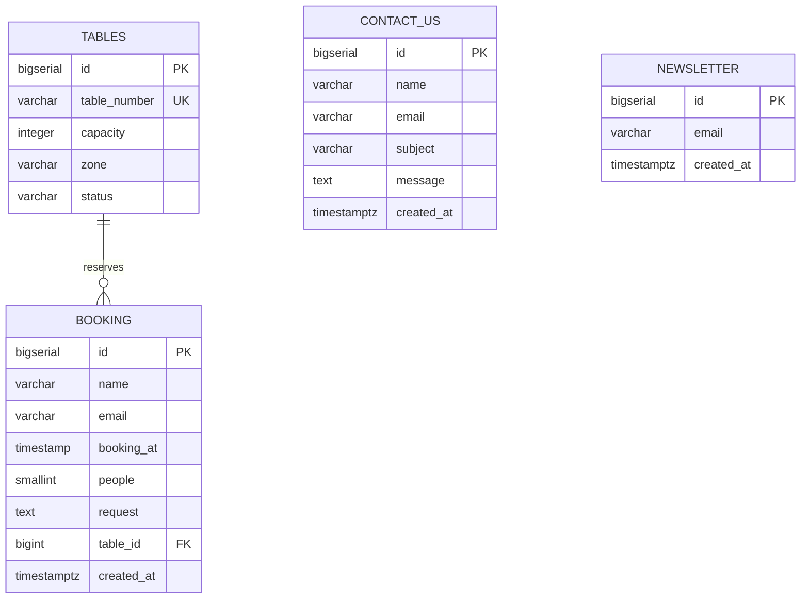
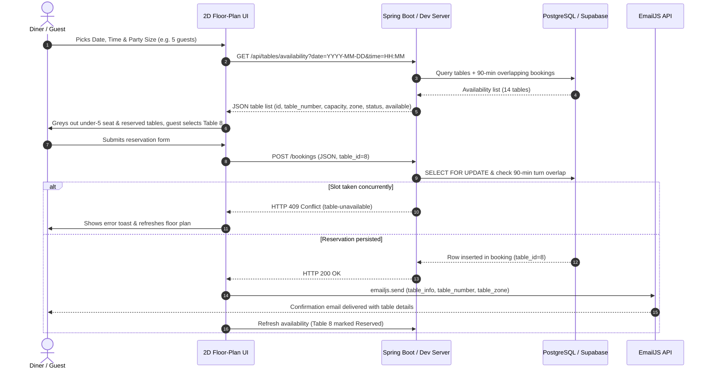

<p align="center">
  
</p>

# 🍽️ OmRestaurant — Modern Restaurant & Dining Experience Platform

> **Exquisite dining, interactive 2D floor-plan table reservations, and automated guest notifications.**  
> **Explore. Pick Your Table. Reserve. Savor.**

[](https://github.com/gopaljilab/OmRestaurant/actions/workflows/ci-cd.yml)
[](https://spring.io/projects/spring-boot)
[](https://www.oracle.com/java/)
[](https://supabase.com/)
[](#docker--containers)
[](https://gsap.com/)
[](https://developer.mozilla.org/en-US/docs/Web/API/WebGLRenderingContext)
[](https://www.emailjs.com/)
[](https://getbootstrap.com/)
[](#license--third-party-notices)

🚀 [Live Dev Server (Port 8000)](#3-run-with-python-dev-server-recommended) &nbsp;·&nbsp; ☕ [Spring Boot (Port 8080)](#4-run-with-spring-boot) &nbsp;·&nbsp; 🐳 [Docker Compose](#docker--containers) &nbsp;·&nbsp; ⚙️ [CI/CD Pipeline](#cicd-pipeline) &nbsp;·&nbsp; 🗺️ [2D Floor-Plan Picker](#interactive-2d-floor-plan-table-picker)

OmRestaurant is a responsive restaurant web platform combining interactive visual table reservations, real-time dining slot availability checks, automated EmailJS confirmations, GPU-accelerated ambient visuals, and PostgreSQL / Supabase persistence—packaged for local dev, standalone Java 21 Spring Boot, Docker Compose, and GitHub Actions CI/CD.

**🗺️ 2D SVG Table Picker** &nbsp;·&nbsp; **✨ WebGL & GSAP Animations** &nbsp;·&nbsp; **⚡ Instant EmailJS Notifications** &nbsp;·&nbsp; **🐳 Docker + CI/CD** &nbsp;·&nbsp; **♿ Reduced-Motion Accessible**

---

## Table of Contents

- [Core Users](#core-users)
- [Project Highlights](#project-highlights)
- [Repository Statistics](#repository-statistics)
- [Feature Overview](#feature-overview)
- [Page Showcase](#page-showcase)
- [Interactive 2D Floor-Plan Table Picker](#interactive-2d-floor-plan-table-picker)
- [Visual Effects, Animations & UI Interactions](#visual-effects-animations--ui-interactions)
- [System Architecture](#system-architecture)
- [Data Model](#data-model)
- [End-to-End Reservation & Notification Flow](#end-to-end-reservation--notification-flow)
- [Tech Stack](#tech-stack)
- [Project Metrics](#project-metrics)
- [Design Principles](#design-principles)
- [Project Structure](#project-structure)
- [Prerequisites](#prerequisites)
- [Getting Started](#getting-started)
  - [1. Clone and Navigate](#1-clone-and-navigate)
  - [2. Configure Database (Supabase PostgreSQL)](#2-configure-database-supabase-postgresql)
  - [3. Run with Python Dev Server (Recommended)](#3-run-with-python-dev-server-recommended)
  - [4. Run with Spring Boot](#4-run-with-spring-boot)
  - [5. Build Standalone Production JAR](#5-build-standalone-production-jar)
- [Docker & Containers](#docker--containers)
- [CI/CD Pipeline](#cicd-pipeline)
- [API & Form Endpoints](#api--form-endpoints)
- [EmailJS Configuration](#emailjs-configuration)
  - [Configured Credentials](#configured-credentials)
  - [Template Placeholders](#template-placeholders)
- [Security & Accessibility](#security--accessibility)
- [Performance & Optimization](#performance--optimization)
- [Project Vision](#project-vision)
- [Future Roadmap](#future-roadmap)
- [License & Third-Party Notices](#license--third-party-notices)

---

## Core Users

| User | Purpose |
| --- | --- |
| **Guests & Diners** | Explore menus, inspect real-time table availability across dining zones on the 2D floor plan, pick specific tables, and receive instant EmailJS confirmations. |
| **Subscribers** | Receive automated welcome emails and updates on seasonal specials and events. |
| **Restaurant Staff & Hosts** | Prevent overlapping table double-bookings via ±90-minute turn-window locks, track reservations (`table_id`), and manage guest inquiries. |

---

## Project Highlights

- **Interactive 2D SVG Floor-Plan Table Picker:** Real-time dining map on `booking.html` and `#floorPlanModal` featuring 14 tables across **Window-Side**, **Main Dining Room**, **Outdoor Patio**, and **VIP Private Booths** with instant party-size filtering and hover tooltips.
- **Transactional Conflict Protection:** `POST /bookings` uses PostgreSQL `SELECT ... FOR UPDATE` row locking and ±90-minute turn-window overlap detection (`409 Conflict` JSON or PRG alert) before sending EmailJS confirmation.
- **Premium Native Animations & Micro-Interactions:** Bundled GSAP 3.13 + `IntersectionObserver` scroll & menu-tab reveals, word-mask heading animations, 3D card tilt with cursor spotlight glow, shimmer/magnetic CTA buttons, hero particle canvas, smooth page transitions, and accessible ARIA toasts.
- **Dual Runtime + Docker Support:** Run via **Spring Boot 4** (`8080`), **Python Dev Server** (`8000`), or **`docker compose up --build`** with PostgreSQL 16 and automated schema seeding.
- **Automated GitHub Actions CI/CD:** Validates JS/Python syntax, root-to-static asset parity, Maven production builds, live Spring Boot + PostgreSQL 16 API smoke tests, and multi-stage GHCR Docker image publishing.

---

## Repository Statistics

| 🏗️ Architecture | 🌐 Runtime Modes | 📄 Pages | 🔌 API & Form Routes | 🗄️ Database | 🎨 Graphics | 🐳 DevOps |
| :---: | :---: | :---: | :---: | :---: | :---: | :---: |
| **Dual-Entry Web App** | **Spring Boot / Python / Docker** | **8 Full Pages** | **4 Endpoints** | **4 PostgreSQL Tables** | **WebGL + Canvas + SVG + GSAP** | **Docker + GitHub Actions** |

---

## Feature Overview

| 🗺️ 2D Visual Floor Plan | 🍽️ Culinary Showcase | ⚡ Instant EmailJS Dispatch |
| --- | --- | --- |
| Select exact tables by zone and capacity with live slot availability and `#FD6B10` highlights. | Filterable Breakfast, Lunch, and Dinner menus with staggered GSAP tab reveal animations. | Automated reservation, contact inquiry, and newsletter confirmation emails including table metadata. |

| 🛡️ Conflict-Safe Bookings | ✨ Motion & Toast UI | ☁️ Cloud / Local Postgres |
| --- | --- | --- |
| Transactional row locks block overlapping reservations within a ±90-minute window. | Hardware WebGL glow, 3D card tilt, page transitions, and non-blocking ARIA toast notifications. | Pre-configured for Supabase PostgreSQL with local PostgreSQL 16 Docker support. |

---

## Page Showcase

The platform features 8 interconnected pages (mirrored between project root and `src/main/resources/static/`):

- **`index.html`** — Restaurant landing page with hero WebGL + floating particle canvas, animated stats counters, team showcase, testimonials, inline quick booking, and newsletter footer.
- **`booking.html`** — Full interactive reservation workspace featuring the **2D SVG Floor-Plan Table Picker** (`inline` + `#floorPlanModal`), zone filter pills, party-size validation, live slot sync, and reservation form.
- **`menu.html`** — Breakfast, Lunch, and Dinner tabbed showcase with GSAP staggered item reveals.
- **`service.html`** — Catering, Master Chefs, Online Ordering, and 24/7 service cards with 3D tilt and cursor spotlight glow.
- **`team.html`** — Chef profiles with 3D tilt/glow cards and social quick links.
- **`about.html`** — Story, photo gallery zoom reveals, and GSAP-driven experience/chef counters.
- **`testimonial.html`** — Owl Carousel guest reviews.
- **`contact.html`** — Embedded Google Map, department addresses, and EmailJS contact form.

---

## Interactive 2D Floor-Plan Table Picker

Mounted on [`booking.html`](booking.html) via [`js/table-picker.js`](js/table-picker.js) (both inline `#om-table-picker` and fullscreen modal `#floorPlanModal`):

- **4 Architectural Zones (14 Physical Tables):**
  - **Window-Side Seating (`Window`):** Tables `1–4` (2-seaters overlooking the panoramic glass wall)
  - **Main Dining Room (`Main`):** Tables `5–7` (4-seaters) & Tables `8–9` (6-seaters)
  - **Outdoor Patio / Terrace (`Patio`):** Table `10` (2-seater) & Tables `11–12` (4-seaters)
  - **Private Booths (`Booth`):** Table `13` (6-seat VIP Booth) & Table `14` (8-seat Grand Booth)
- **Visual Table States:**
  - **Available:** Brand-outlined interactive geometry with chair silhouettes and hover glow.
  - **Selected (`#FD6B10`):** Instant warm accent highlight, glow filter, and top-right checkmark badge synced to `input[name="table_id"]` and `#om-selected-table-pill`.
  - **Reserved:** Diagonal hatch pattern and disabled cursor for tables marked reserved or booked within ±90 minutes of the chosen `YYYY-MM-DDTHH:MM` slot.
  - **Too Small for Party Size:** Dimmed dashed outline when `table.capacity < partySize`, popping an explanatory toast if clicked (and auto-deselecting if the guest increases party size).

---

## Visual Effects, Animations & UI Interactions

Implemented natively across [`js/webgl-hero.js`](js/webgl-hero.js), [`js/particles.js`](js/particles.js), [`js/animations.js`](js/animations.js), and [`css/style.css`](css/style.css):

- **Ambient WebGL & Canvas Particles:** Hardware-accelerated fragment shader glow on all `.hero-header` sections plus upward-drifting warm amber bokeh particles on the home hero (`particles.js`).
- **Word-Mask Text & Scroll Reveals:** `IntersectionObserver` + GSAP word-mask reveals (preserving `<br>`, icons, and full `aria-label` text) alongside zoom/fade-up `.om-reveal` blocks.
- **Micro-Interactions:** Cursor-tracking 3D perspective tilt + `.om-card-glow` spotlight on team/service cards, diagonal shine sweep on `.btn-primary`, magnetic cursor pull on primary CTAs & play button, and `::before` navbar link underline slides.
- **Page Transitions & Toast Feedback:** Top amber progress bar (`#om-page-progress`) + blur veil (`pageshow` bfcache-safe) and non-blocking ARIA toasts (`window.showOmToast`) replacing browser `alert()`.
- **Accessibility:** Honors `@media (prefers-reduced-motion: reduce)` and `matchMedia("(prefers-reduced-motion: reduce)")`, disabling continuous shaders, particles, transitions, and tilts automatically.

---

## System Architecture



---

## Data Model



---

## End-to-End Reservation & Notification Flow



---

## Tech Stack

| Layer | Technology | Details |
| --- | --- | --- |
| **Frontend & Floor Plan** | HTML5, Bootstrap 5, CSS3, Vanilla JS, Inline SVG | Responsive multi-page UI with SVG 2D dining floor plan |
| **Motion & Shaders** | GSAP 3.13.0, ScrollToPlugin, Canvas 2D, GLSL WebGL | Locally bundled in `lib/gsap/`, custom glow shaders & particles |
| **Email Service** | EmailJS Browser SDK v4 | Locally bundled in `lib/emailjs/` for instant inbox delivery |
| **Backend (Primary)** | Java 21 / 26, Spring Boot 4.1.1 | Spring Web MVC, Spring JDBC, HikariCP, `@Transactional` row locks |
| **Backend (Dev)** | Python 3.9+ | Built-in HTTP server with `/api/tables/availability`, SQLite, and Supabase sync |
| **Database** | PostgreSQL 16 (Supabase Cloud or Docker) | `tables`, `booking` (with `table_id` FK), `contact_us`, `newsletter` |
| **Containers & CI/CD** | Docker, Docker Compose, GitHub Actions | Multi-stage JRE 21 Alpine image, GHCR publishing, automated Postgres integration tests |

---

## Project Metrics

| Metric | Detail |
| --- | --- |
| **Web Pages** | 8 full HTML pages (mirrored cleanly between root and `src/main/resources/static/`) |
| **Endpoints** | 4 routes (`GET /api/tables/availability`, `POST /bookings`, `POST /contact`, `POST /newsletter`) |
| **Database Tables** | 4 relational tables (`tables`, `booking`, `contact_us`, `newsletter`) |
| **Floor Plan Capacity** | 14 seeded physical tables across 4 dining zones (`2`, `4`, `6`, `8` seats) |
| **CI/CD Jobs** | 3 automated pipeline jobs (`frontend-checks`, `build-and-test`, `docker`) |

---

## Design Principles

- **Zero-CDN Vendor Resilience:** GSAP, ScrollToPlugin, and EmailJS are bundled in `lib/` for deterministic loading without external JS CDN outages.
- **Progressive Fallback:** Missing WebGL falls back cleanly to hero background photography; offline static previews fall back to the local floor-plan JSON config.
- **Double-Booking Safety:** Row-level `FOR UPDATE` locking + ±90-minute turn-window queries prevent race conditions across concurrent guests.
- **Accessibility First:** Keyboard focusable SVG tables (`role="button"`, `tabindex="0"`, `Enter`/`Space` selection), ARIA live toasts, and `prefers-reduced-motion` support across all scripts and styles.

---

## Project Structure

```text
OmRestaurant/
├── .github/workflows/
│   └── ci-cd.yml                              # GitHub Actions CI/CD (checks, Postgres tests, GHCR Docker)
├── assets/
│   └── omrestaurant-banner.jpg                # Custom README hero banner graphic
├── css/
│   ├── bootstrap.min.css                      # Bootstrap 5 core CSS
│   └── style.css                              # Theme styles, UI animations, & 2D floor plan styles
├── js/
│   ├── animations.js                          # Scroll/tab reveals, word-mask text, tilt/glow, transitions, toasts
│   ├── email-config.js                        # EmailJS credentials & template configuration
│   ├── email-service.js                       # Booking transaction coordinator, contact & newsletter dispatch
│   ├── main.js                                # Navbar sticky/scroll logic, modals, PRG status toasts
│   ├── particles.js                           # Home hero Canvas 2D warm bokeh particle engine
│   ├── table-picker.js                        # Modular 2D SVG floor-plan component & live availability sync
│   └── webgl-hero.js                          # WebGL fragment shader hero glow engine
├── lib/                                       # Locally bundled EmailJS, GSAP, WOW, Owl Carousel, Tempus Dominus
├── img/                                       # Photography & graphic assets
├── database/
│   ├── omRest_db.sql                          # Standalone MySQL schema reference
│   └── supabase_floor_plan_migration.sql      # Idempotent Supabase PostgreSQL floor-plan migration + seed
├── src/main/
│   ├── java/com/omrestaurant/
│   │   ├── OmRestaurantApplication.java       # Spring Boot entrypoint
│   │   ├── model/RestaurantTable.java         # Table availability DTO record
│   │   ├── service/FormService.java           # Availability checks, row-locked booking & JDBC persistence
│   │   └── web/
│   │       ├── FormController.java            # /bookings, /contact, /newsletter controller (JSON + PRG)
│   │       └── TableController.java           # GET /api/tables/availability REST endpoint
│   └── resources/
│       ├── application.properties             # JDBC pool config (env-overridable for Docker / Supabase)
│       ├── schema.sql                         # Automatic PostgreSQL DDL + idempotent 14-table seed
│       └── static/                            # Packaged Spring Boot static web assets mirror
├── Dockerfile                                 # Multi-stage Maven + Eclipse Temurin 21 JRE Alpine image
├── docker-compose.yml                         # Spring Boot app + PostgreSQL 16 service stack
├── .dockerignore                              # Optimized Docker build context exclusions
├── .env.example                               # Environment variable template (Docker / Supabase)
├── dev_server.py                              # Python 3 dev server with table availability & SQLite/Supabase sync
├── pom.xml                                    # Maven build configuration (Spring Boot 4.1.1 / Java 21)
├── THIRD-PARTY-NOTICES.md                     # Third-party library licenses
└── README.md                                  # Project documentation
```

---

## Prerequisites

- **Java JDK 21+** and **Apache Maven 3.9+** (for Spring Boot builds), **or**
- **Docker Desktop / Docker Engine + Compose v2** (for single-command containerized startup), **or**
- **Python 3.9+** (for lightweight zero-dependency local development via `dev_server.py`)

---

## Getting Started

### 1. Clone and Navigate

```bash
git clone https://github.com/gopaljilab/OmRestaurant.git
cd OmRestaurant
```

### 2. Configure Database (Supabase PostgreSQL)

For **existing Supabase databases**, run [`database/supabase_floor_plan_migration.sql`](database/supabase_floor_plan_migration.sql) in the **Supabase SQL Editor** (Spring Boot also runs [`src/main/resources/schema.sql`](src/main/resources/schema.sql) idempotently when `spring.sql.init.mode=always`).

Set environment variables (or copy [`.env.example`](.env.example) to `.env`):

```bash
export DB_URL='jdbc:postgresql://aws-0-eu-west-1.pooler.supabase.com:5432/postgres?sslmode=require'
export DB_USERNAME='postgres.ujiftprtpulyhudloyvp'
export DB_PASSWORD='your-supabase-password'
```

### 3. Run with Python Dev Server (Recommended)

```bash
python3 dev_server.py
```

Open `http://localhost:8000/booking.html` to test the interactive 2D floor plan immediately backed by local SQLite (`omrestaurant.sqlite3`) and optional Supabase `psql` synchronization.

### 4. Run with Spring Boot

```bash
mvn spring-boot:run
```

Open `http://localhost:8080/booking.html`.

### 5. Build Standalone Production JAR

```bash
mvn clean package -DskipTests
java -jar target/omrestaurant-1.0.0.jar
```

---

## Docker & Containers

### Run the Full Stack with Docker Compose (App + PostgreSQL 16)

Start both the Spring Boot application (`8080`) and a persistent `postgres:16-alpine` database (`5432`) automatically seeded with `schema.sql`:

```bash
docker compose up --build -d
```

Open `http://localhost:8080/booking.html`. To tear down containers (keeping database volume intact):

```bash
docker compose down
```

### Connect the Container to Supabase Instead of Local Postgres

1. Copy [`.env.example`](.env.example) to `.env` and fill in your Supabase `DB_URL`, `DB_USERNAME`, and `DB_PASSWORD`.
2. Start only the web service without the local Postgres container:

```bash
docker compose up --build -d --no-deps web
```

### Standalone Docker Build & Run

```bash
docker build -t omrestaurant:latest .
docker run --rm -p 8080:8080 \
  -e DB_URL="jdbc:postgresql://aws-0-eu-west-1.pooler.supabase.com:5432/postgres?sslmode=require" \
  -e DB_USERNAME="postgres.ujiftprtpulyhudloyvp" \
  -e DB_PASSWORD="your-supabase-password" \
  omrestaurant:latest
```

---

## CI/CD Pipeline

Defined in [`.github/workflows/ci-cd.yml`](.github/workflows/ci-cd.yml) and triggered on pushes/PRs to `main` plus manual `workflow_dispatch`:

1. **`frontend-checks`**
   - Runs `node --check` syntax validation across all root and `static/` JavaScript modules.
   - Runs `python3 -m py_compile dev_server.py`.
   - Enforces exact asset parity (`diff -u`) between root `css/` / `js/` and `src/main/resources/static/`.
2. **`build-and-test`**
   - Provisions a live **`postgres:16-alpine`** GitHub Actions service container.
   - Packages `target/omrestaurant-1.0.0.jar` with `mvn -B clean package` on Java 21 (Temurin).
   - Boots the compiled JAR against PostgreSQL 16 and executes live HTTP assertions covering `GET /api/tables/availability`, booking `table_id=5`, ±90-minute conflict rejection (`409 Conflict`), and capacity enforcement (`400 Bad Request`).
   - Uploads the compiled JAR as a build artifact.
3. **`docker`** *(runs after both jobs pass)*
   - Builds the multi-stage [`Dockerfile`](Dockerfile) with Buildx + GitHub Actions layer caching (`type=gha`).
   - On pushes to `main`, logs into **GitHub Container Registry** (`ghcr.io/gopaljilab/omrestaurant`) using `GITHUB_TOKEN` and pushes `:latest` + `:sha-<commit>`.

---

## API & Form Endpoints

| Route | Method | Query / Body Fields | Destination / Response |
| --- | :---: | --- | --- |
| `/api/tables/availability` | `GET` | `date` (`YYYY-MM-DD`), `time` (`HH:MM`) | JSON list of 14 tables (`id`, `table_number`, `capacity`, `zone`, `status`, `available`) |
| `/bookings` | `POST` | `name`, `email`, `date`, `people`, `request`, `table_id` (optional) | Inserts row in `booking`; returns JSON (`200`/`409`/`400`) when `Accept: application/json`, or redirects (`?status=booking-success` / `table-unavailable` / `invalid`) |
| `/contact` | `POST` | `name`, `email`, `subject`, `message` | Inserts row in `contact_us` & redirects (`?status=contact-success`) |
| `/newsletter` | `POST` | `email` | Inserts row in `newsletter` & redirects (`?status=newsletter-success`) |

---

## EmailJS Configuration

EmailJS is integrated to deliver real-time confirmation emails from the guest's browser.

### Configured Credentials

Stored in [`js/email-config.js`](js/email-config.js) and [`src/main/resources/static/js/email-config.js`](src/main/resources/static/js/email-config.js):

```javascript
window.EMAILJS_CONFIG = {
    publicKey: "oMUTFQVOur_fOnw_t",
    serviceId: "service_da1y4nn",
    forms: {
        newsletter: {
            publicKey: "oMUTFQVOur_fOnw_t",
            serviceId: "service_da1y4nn",
            templateId: "template_0by6ed7"
        },
        booking: {
            publicKey: "oMUTFQVOur_fOnw_t",
            serviceId: "service_da1y4nn",
            templateId: "template_7uffzct"
        },
        contact: {
            publicKey: "OVv3HY-kOjQfzS0GV",
            serviceId: "service_lf56m2o",
            templateId: "template_e6tjmba"
        }
    }
};
```

### Template Placeholders

- **Newsletter Form:** `{{to_email}}`, `{{email}}`, `{{subscriber_email}}`, `{{to_name}}`, `{{from_name}}`, `{{message}}`, `{{date}}`, `{{time}}`
- **Booking Form:** `{{name}}`, `{{to_name}}`, `{{guest_name}}`, `{{email}}`, `{{to_email}}`, `{{date}}`, `{{booking_date}}`, `{{people}}`, `{{table_id}}`, `{{table_number}}`, `{{table_zone}}`, `{{table_info}}`, `{{request}}`, `{{from_name}}`
- **Contact Form:** `{{name}}`, `{{to_name}}`, `{{email}}`, `{{to_email}}`, `{{subject}}`, `{{message}}`, `{{date}}`, `{{time}}`

---

## Security & Accessibility

- **SQL Injection Prevention:** Parameterized Spring `JdbcTemplate` and SQLite queries everywhere.
- **Transactional Concurrency Guard:** `FOR UPDATE` row locks protect physical dining tables against double-booking races.
- **Non-Root Container Runtime:** Docker runtime stage runs as unprivileged `appuser` on minimal `eclipse-temurin:21-jre-alpine`.
- **Encrypted Cloud Connections:** Supabase JDBC datasource enforces `sslmode=require`.
- **Accessible Motion & Keyboard Support:** Full `prefers-reduced-motion` opt-outs across WebGL, Canvas 2D, GSAP, and SVG transitions, plus keyboard-navigable table elements (`Tab` / `Enter` / `Space`).

---

## Performance & Optimization

- **Zero External JS CDN Bottlenecks:** Locally bundled GSAP and EmailJS eliminate render-blocking CDN variance.
- **Hardware Shader & Particle Capping:** Canvas resolution scales smoothly up to `1.5x` `devicePixelRatio` and halts off-screen/hidden loops automatically.
- **Layered Docker Caching:** Multi-stage `Dockerfile` caches Maven dependency downloads separately from application compilation.

---

## Project Vision

> **OmRestaurant bridges tactile visual table selection with reliable transactional reservations—delivering effortless dining discovery for guests and zero-conflict scheduling for restaurant teams.**

---

## Future Roadmap

- [x] Responsive 8-page restaurant layout
- [x] Hardware-accelerated WebGL ambient glow shader & hero bokeh particles
- [x] Locally bundled GSAP animations, scroll/tab reveals & accessible toasts
- [x] Cloud database support on Supabase PostgreSQL
- [x] Client-side EmailJS integration for bookings, inquiries, and newsletters
- [x] Dual-runtime support (Spring Boot 4 & Python dev server)
- [x] Interactive 2D floor-plan table picker with real-time availability API
- [x] Docker / Docker Compose setup & GitHub Actions CI/CD pipeline
- [ ] Online takeout & delivery ordering workflow
- [ ] Payment gateway integration (Stripe / Razorpay)
- [ ] SMS confirmation notifications via Twilio
- [ ] Administrative dashboard with reservation calendar and analytics

---

## License & Third-Party Notices

This project is licensed under the **MIT License**.

### Third-Party Acknowledgments
- **GSAP & ScrollToPlugin:** Bundled under the GreenSock Standard License. See [gsap.com/standard-license](https://gsap.com/standard-license/).
- **EmailJS Browser SDK:** Distributed under the Apache-2.0 License. See [emailjs.com](https://www.emailjs.com/).
- Additional third-party details are documented in [`THIRD-PARTY-NOTICES.md`](THIRD-PARTY-NOTICES.md).
